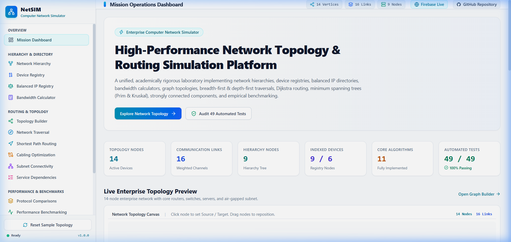
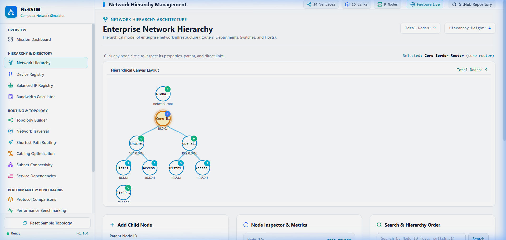
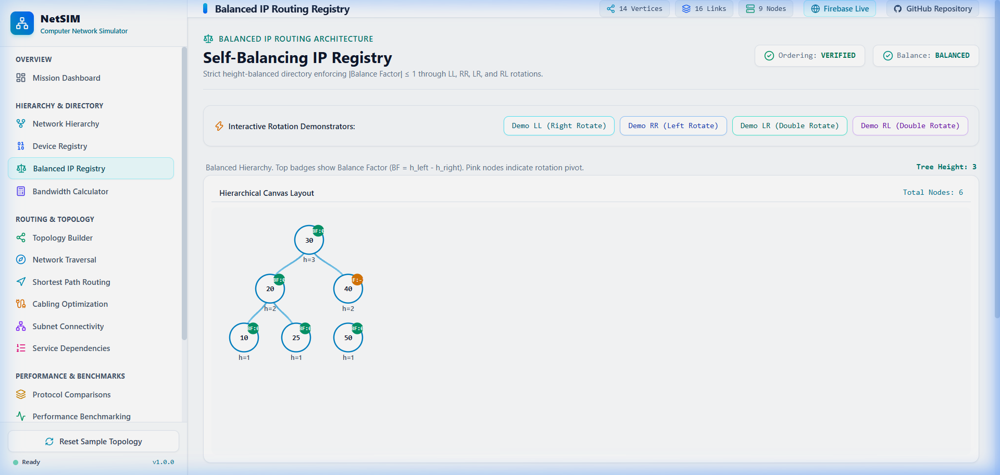
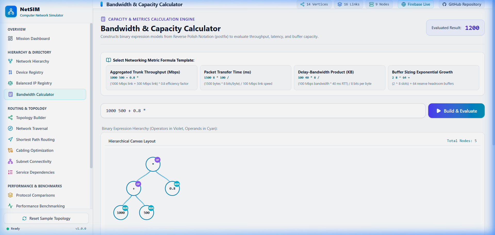
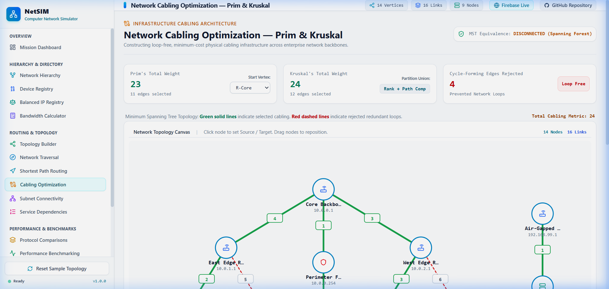

# Computer Network Simulator (NetSIM)

[](https://computer-network-simulator.web.app)
[](https://github.com/Nadin-kishore-R/computer-network-simulator.git)
[-6E9F18?style=for-the-badge&logo=vitest&logoColor=white)](https://computer-network-simulator.web.app)
[](https://www.typescriptlang.org/)
[](https://react.dev/)
[](https://tailwindcss.com/)

> **NetSIM: An advanced, interactive Computer Network Simulation Platform** featuring complete algorithmic implementations for network hierarchies, device directories, self-balancing registries, bandwidth calculators, graph topologies, breadth-first & depth-first traversals, Dijkstra routing, minimum spanning trees via Prim & Kruskal, strongly connected components, and empirical benchmarking. Designed with a clean, high-contrast bright silvery white theme.

---

## 📌 Project Overview
The **Computer Network Simulator (NetSIM)** models enterprise computer networking architectures through interactive algorithms. Rather than relying on third-party black-box libraries, all algorithmic models, traversal mechanics, and optimization protocols are implemented from scratch in pure TypeScript.

The simulator models:
* **Network Hierarchies** using multi-way hierarchical trees.
* **IP and Hardware Registries** using binary search directories and self-balancing AVL trees.
* **Bandwidth and Buffer Sizing Calculations** using Postfix Expression Trees.
* **Subnet Topologies** using a Graph ADT supporting Adjacency Matrices and Adjacency Lists.
* **Minimum-Hop vs. Minimum-Latency Routing** comparing unweighted BFS and greedy Dijkstra.
* **Physical Cabling Optimization** through Prim's cut-property and Kruskal's cycle-avoiding partition sets.
* **Service Dependency Scheduling** using Kahn's algorithm and DFS topological sort with circular deadlock detection.
* **Empirical Latency Benchmarking** measuring actual runtime via browser high-resolution timers (`performance.now()`).

---

## 📸 Genuine Application Screenshots

### 1. Mission Operations Dashboard

*Real-time enterprise network overview featuring KPI counters, live topology visualizer, and event audit trail in bright theme.*

---

### 2. Network Hierarchy Management

*Interactive multi-way tree representing routers, subnets, switches, and hosts with height, depth, and traversal metrics.*

---

### 3. Self-Balancing IP Registry — Rotations & Rebalancing

*Dynamic balanced directory displaying live Balance Factors ($|BF| \le 1$), automated LL, RR, LR, and RL rotations, and step-by-step rebalancing history.*

---

### 4. Bandwidth Calculator — Expression Engine

*Interactive Expression model synthesis from Reverse Polish Notation, evaluating networking throughput and delay-bandwidth products.*

---

### 5. Cabling Optimization — Prim & Kruskal Minimum Spanning Tree

*Loop-free physical cabling optimization: Green solid lines represent selected minimum cabling; red dashed lines represent rejected cycle-forming links.*

---

## 🚀 Key Modules & Architecture

### 🌲 Hierarchy & Directory Architecture
* **Network Hierarchy**:
  * Operations: Root initialization, child insertion, subtree pruning, searching by ID, parent/child inspection.
  * Metrics: Hierarchy height, node depth, total node counting.
  * Traversals: Preorder, Postorder, Level-order (BFS queue).
* **Device Registry**:
  * Operations: Keyed insertion, search path tracking, deletion (Leaf, Single Child, Two Children with in-order successor).
  * Queries: Minimum, Maximum, Inorder Successor, Inorder Predecessor, and Range Queries `[minKey, maxKey]`.
  * Duplicate Policy: Strict unique keys enforced to preserve bijection with physical hardware MAC/IP addresses.
* **Balanced IP Registry**:
  * Self-balancing mechanism: Balance Factor $BF = h_{left} - h_{right} \in \{-1, 0, 1\}$.
  * Automatic Rotations: Single Right (LL), Single Left (RR), Left-Right (LR), and Right-Left (RL).
  * Real-time verification: Ordering invariant and balance property checked on every mutation.
* **Bandwidth Calculator**:
  * Postfix parser: Operator validation (`+`, `-`, `*`, `/`, `^`, `%`) and operand numerical validation.
  * Synthesizer: Constructs binary expression trees with Inorder, Preorder, and Postorder outputs.
  * Step-by-step evaluator: Step table showing intermediate stack states and safe zero-division handling.

### 🌐 Topology & Routing Architecture
* **Network Topology Graph**:
  * Directed, Undirected, Weighted, and Unweighted graph modes.
  * Dual representations: Adjacency Matrix and Adjacency List.
  * Dynamic operations: Vertex addition/deletion, edge addition/deletion, edge weight updates.
  * Preset templates: 14-Node Enterprise Network, Directed Acyclic Graph (DAG), and Cyclic Dependency Network.
* **Network Traversal (BFS & DFS)**:
  * Breadth-First Search (BFS): Computes hop-count distances and handles disconnected islands cleanly.
  * Depth-First Search (DFS): Implements both recursive and iterative (explicit stack) traversals.
  * Edge Classification: Categorizes edges into Tree, Back (cycle indicator), Forward, and Cross edges.
  * Timestamps: Records discovery ($d[v]$) and finishing ($f[v]$) timestamps.
* **Shortest Path Routing (Dijkstra)**:
  * Min-Priority Queue (Binary Heap) implemented from scratch.
  * Reconstructs shortest path and full distance table.
  * Error checking: Negative edge weight rejection and unreachable node handling.
* **Minimum Spanning Tree (Prim & Kruskal)**:
  * Prim's Algorithm: Priority-driven edge expansion starting from custom root vertex.
  * Kruskal's Algorithm: Edge sorting paired with Disjoint Set Union (DSU) featuring Path Compression and Union by Rank.
  * Loop Prevention: Explicit tracking of rejected cycle-forming edges.
  * Mathematical Equivalence: Verifies equal total weights on connected topologies.
* **Connectivity & Strongly Connected Components (SCC)**:
  * Undirected graph partitioning into connected equivalence classes.
  * Directed graph decomposition into maximal SCCs using Tarjan's algorithm.
* **Topological Sorting & Cycle Detection**:
  * Kahn's Algorithm (in-degree BFS) and DFS reverse postorder.
  * Cycle Deadlock Detection: Immediately flags cyclic dependencies and verifies directed edge constraints.

### 🔬 Performance & Benchmarking Analysis
* **Comparative Studies**:
  * BFS vs. Dijkstra: Features a concrete divergent topology where the minimum-hop route (100ms) differs from the minimum-latency route (30ms).
  * Prim vs. Kruskal: Dense vs. sparse graph efficiencies and DSU mechanics.
  * Standard vs. Balanced Directories: Degenerate $O(n)$ linear skew vs. guaranteed $O(\log n)$ balance bound.
* **Empirical Benchmarking Laboratory**:
  * Real-world timing execution using `performance.now()` across hierarchy sizes (1k, 5k, 20k) and graph vertices (200, 1k, 2k).
  * Reproducible experiments using a deterministic Linear Congruential PRNG (`SeededRandom`).
  * Live comparison charts rendered with Recharts.
* **Complexity Theory Matrix**:
  * Formal asymptotic definitions for Big $O$, $\Omega$, and $\Theta$.
  * Master Theorem cases for divide-and-conquer recurrences.
  * Amortized analysis of DSU $\alpha(n)$ (Inverse Ackermann function).

---

## 📊 Theoretical Complexity Reference Matrix

| Protocol / Algorithm | Best Case Time | Average Case Time | Worst Case Time | Space Complexity |
| :--- | :--- | :--- | :--- | :--- |
| **General Tree (Hierarchy)** | $O(1)$ | $O(n)$ | $O(n)$ | $O(n)$ |
| **Device Registry (BST)** | $O(1)$ | $O(\log n)$ | $O(n)$ (Skewed) | $O(n)$ |
| **Balanced IP Registry (AVL)** | $O(1)$ | $O(\log n)$ | $O(\log n)$ (Guaranteed) | $O(n)$ |
| **Expression Tree Engine** | $O(m)$ | $O(m)$ | $O(m)$ | $O(m)$ |
| **Breadth-First Search (BFS)** | $O(V + E)$ | $O(V + E)$ | $O(V + E)$ | $O(V)$ |
| **Depth-First Search (DFS)** | $O(V + E)$ | $O(V + E)$ | $O(V + E)$ | $O(V)$ |
| **Dijkstra (Binary Min-Heap)** | $O((V + E) \log V)$ | $O((V + E) \log V)$ | $O((V + E) \log V)$ | $O(V)$ |
| **Prim's MST Algorithm** | $O(E \log V)$ | $O(E \log V)$ | $O(E \log V)$ | $O(V)$ |
| **Kruskal's MST with DSU** | $O(E \log E)$ | $O(E \log E) \approx O(E \log V)$ | $O(E \log E)$ | $O(E + V)$ |
| **Tarjan's SCC Algorithm** | $O(V + E)$ | $O(V + E)$ | $O(V + E)$ | $O(V)$ |
| **Topological Sort (Kahn / DFS)** | $O(V + E)$ | $O(V + E)$ | $O(V + E)$ | $O(V)$ |

---

## 🏗️ Project Architecture & Folder Structure

```
computer-network-simulator/
├── public/                 # Static web assets & icons
├── src/
│   ├── algorithms/         # Routing & Graph Algorithms
│   │   ├── bfs.ts          # Breadth-First Search
│   │   ├── dfs.ts          # Depth-First Search (Recursive & Iterative)
│   │   ├── dijkstra.ts     # Dijkstra Shortest Path with Min-Heap
│   │   ├── dsu.ts          # Disjoint Set Union (Rank + Path Compression)
│   │   ├── graph.ts        # Graph ADT (Adjacency Matrix & List)
│   │   ├── kruskal.ts      # Kruskal Minimum Spanning Tree
│   │   ├── prim.ts         # Prim Minimum Spanning Tree
│   │   ├── components.ts   # Connected Components & Tarjan SCC
│   │   └── topologicalSort.ts # Kahn & DFS Topological Ordering
│   ├── analysis/           # Empirical & Theoretical Analysis
│   │   ├── comparisons.ts  # Comparative Analysis & Divergent Topologies
│   │   ├── benchmarking.ts # Live timing benchmarks via performance.now()
│   │   └── complexity.ts   # Asymptotic Complexity & Master Theorem Profiles
│   ├── components/         # Interactive SVG Canvas & Layout UI
│   │   ├── TreeVisualizer.tsx  # Dynamic Hierarchical Canvas
│   │   ├── GraphVisualizer.tsx # Network Topology Canvas with Drag & Markers
│   │   ├── Header.tsx      # System Header with Live Badges
│   │   └── Navigation.tsx  # Sidebar Module Navigator
│   ├── context/            # Shared Network State & Event Audit
│   │   └── NetworkContext.tsx
│   ├── pages/              # 16 Interactive Modules
│   ├── tests/              # 49 Automated Tests (Vitest)
│   │   ├── setup.test.ts
│   │   ├── trees.test.ts
│   │   ├── graphs.test.ts
│   │   └── analysis.test.ts
│   ├── types/              # Type Models
│   │   ├── tree.ts
│   │   └── graph.ts
│   ├── App.tsx             # Master App Router & State Layout
│   ├── index.css           # Bright Silvery White Theme & Tailwind CSS
│   └── main.tsx            # Entry Point
├── screenshots/            # Genuine Captured Application Screenshots
├── firebase.json           # Firebase Hosting SPA Configuration
├── .firebaserc             # Firebase Project Configuration
├── README.md               # GitHub Project Documentation
├── FINAL_TEST_REPORT.md    # Vitest Automated Test Audit
└── DEPLOYMENT_REPORT.md    # Live Hosting & Git Verification Report
```

---

## 💻 Installation & Setup

### Prerequisites
* **Node.js**: v18.0.0 or higher (v24.x recommended)
* **npm**: v9.0.0 or higher
* **Git**: v2.x or higher

### Local Development Setup
```bash
# 1. Clone the GitHub repository
git clone https://github.com/Nadin-kishore-R/computer-network-simulator.git

# 2. Navigate into the project directory
cd computer-network-simulator

# 3. Install dependencies
npm install

# 4. Start local development server
npm run dev
```

### Verification & Testing
```bash
# Execute Vitest automated test suite (49 tests)
npm run test

# Run TypeScript strict type-checking
npm run typecheck

# Build optimized production bundle
npm run build
```

---

## 🌐 Production Deployment (Firebase Hosting)

The application is deployed on Google Firebase Hosting:
* **Firebase Project ID**: `computer-network-simulator`
* **Live Website URL**: [https://computer-network-simulator.web.app](https://computer-network-simulator.web.app)

To deploy updates:
```bash
# 1. Generate production bundle
npm run build

# 2. Deploy to Firebase Hosting
firebase deploy --only hosting --project computer-network-simulator
```

---

## 👥 Engineering Team
* **Lead Architect & Developer**: **Nadin Kishore R**
* **Project**: Computer Network Simulator (NetSIM)
* **Contact**: [nadinkishore24@gmail.com](mailto:nadinkishore24@gmail.com)

---

## 📄 License & Acknowledgements
This project is developed for interactive demonstration and simulation of network engineering algorithms and hierarchical routing protocols. All algorithms are original implementations in pure TypeScript.
